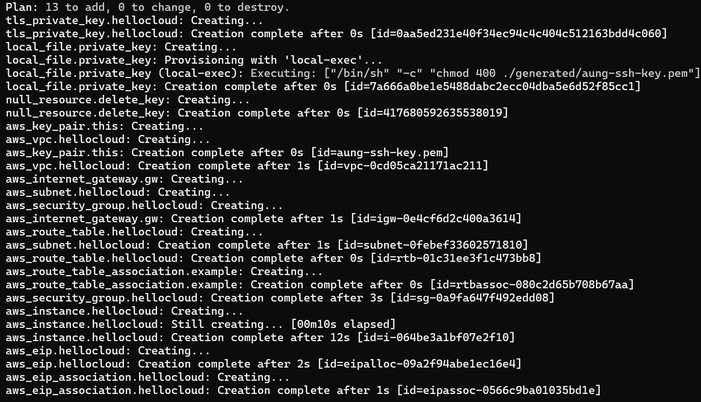

# hellocloud-app-aws terraform analysis (18-Aug-2025)

Category: Terraform
Git Repositoy: https://github.com/Htaung/helloCloud/tree/main/hellocloud-app-aws
Hands-on: Done
Target: August 30, 2026 → September 3, 2026
Watching: Done
Youtube: https://www.youtube.com/watch?v=34VP9O6qmuU&list=PLvzWOIc1IOtddfdvAmnPc6V4RSWHLpn7h&index=31
drawing: https://www.tldraw.com/f/WEn8z8de18_xPmAyBtUTS?d=v-2772.262.8749.4315.page

#### Prerequisites

- Learn about Basic Networking
- **CIDR_VLSM**
- Cloud Infrastructure Overview
- Basic Tutorial
- Understanding JSON, JSON to YAML
- **Understanding AWS ARNs**
- Exploring AWS VPC Part1 and 2
- AWS Cloud Formation Getting Started
- AWS Cloud Formation VPC 1
- AWS Cloud Formation VPC 2

```bash
filter {
    name   = "name"
    values = ["ubuntu/images/hvm-ssd/ubuntu-jammy-22.04-amd64-server-*"]
  }
  
  to find out the values
  
   aws ec2 describe-images --profile master-console-admin    --filters "Name=name,Values=ubuntu/images/hvm-ssd/ubuntu-jammy
-22.04-amd64-server-*"   --query 'sort_by(Images, &CreationDate)[-1].[Name,ImageId]'   --output table
```

- [https://cloud-images.ubuntu.com/locator/ec2/](https://cloud-images.ubuntu.com/locator/ec2/)

**Ubuntu's official AMI locator**: [https://cloud-images.ubuntu.com/locator/ec2/](https://cloud-images.ubuntu.com/locator/ec2/) — lets you search by release name, region, and architecture, and shows the exact AMI name string.

**AWS Console**: EC2 → AMI Catalog → search "ubuntu jammy" (you can see the exact `Name` field there, which is what the filter matches against).

- Execution Order



